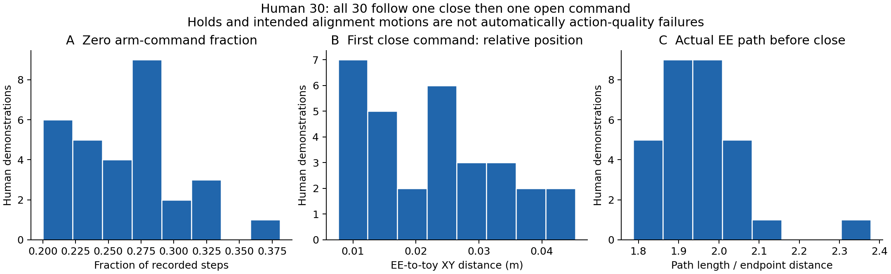
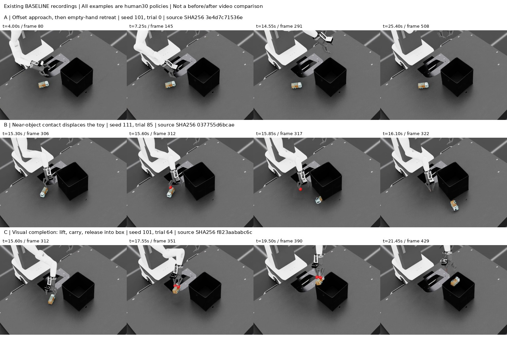
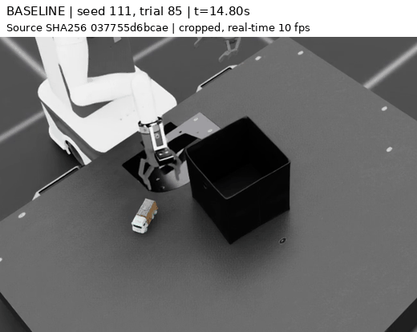
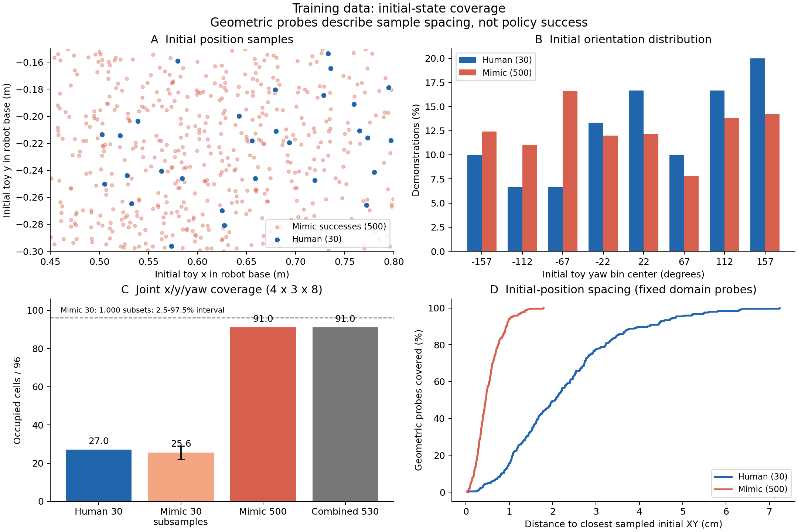
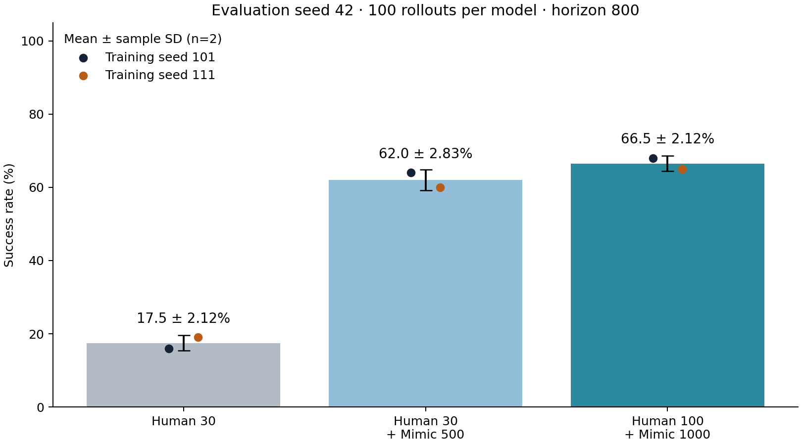
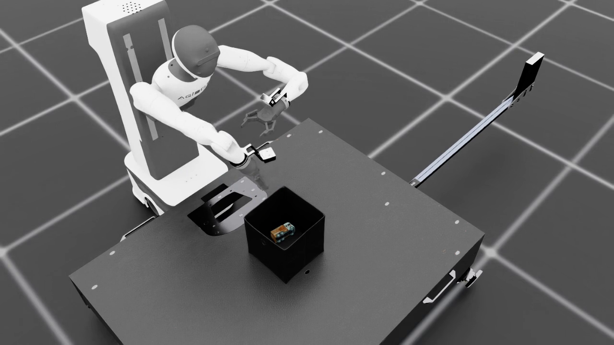
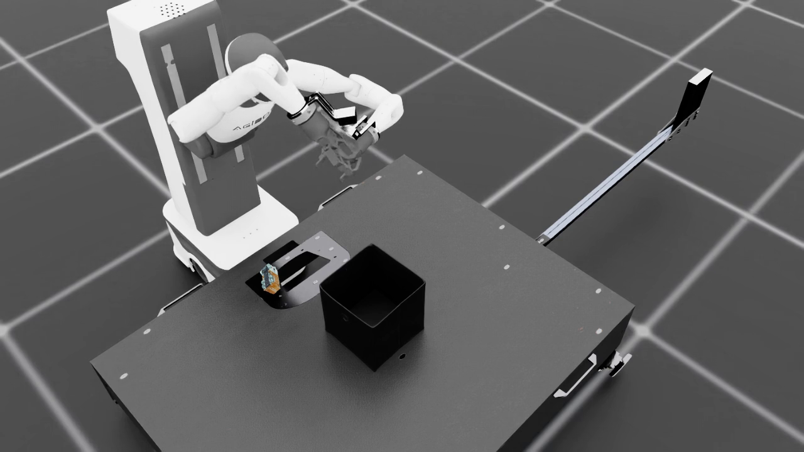

# Toy2Box 모방학습의 물체 획득 실패 진단과 Mimic 증강 효과

키보드 사람 시범 30개로 학습한 BC 정책의 자체 검증 성공률은 **17.5 ± 2.12%**였다. 녹화 영상에서는 물체를 확보하지 못한 채 머무르거나 빈손으로 후속 동작을 수행하는 실패가 반복되었다. HDF5 분석에서는 그리퍼 명령 순서의 일관성이 확인되었지만, 초기 장난감 위치·방향을 함께 고려한 상태 조합은 제한적이었다. 동일 사람 시범에 Mimic 성공 시범 500개를 추가하자 성공률은 **62.0 ± 2.83%**, 평균 **44.5%p** 증가했다.

사람 시범 100개와 Mimic 성공 시범 1,000개를 결합한 데이터 규모 조건에서는 **66.5 ± 2.12%**를 기록했다. 30+500개 조건 대비 **4.5%p** 높은 관측 성공률이다. 앞의 두 조건은 같은 사람 시범에 증강을 추가한 통제 실험이고, 100+1,000개 조건과의 비교는 사람·증강 데이터 수를 함께 늘린 규모 비교다. 두 비교가 답하는 질문을 구분한다.

핵심 해석은 **제한된 시범 수에 따른 상태 조합의 희소성이 물체 획득 구간의 일반화 실패에 기여했을 가능성**이다. 증강으로 초기 상태의 표본 밀도가 높아진 사실과 성공률 개선은 이 설명에 부합한다. 그러나 수집 품질, 데이터 수량, 생성 행동의 변화가 각각 얼마나 기여했는지는 분리하지 못했다.

평가 수치는 평가 seed 42, 모델당 100 rollout, horizon 800의 기록이다. 평균 ± 표준편차는 학습 seed 101·111에 대한 **표본 표준편차(ddof=1, n=2)**를 사용한다. 행동 데이터, 초기 상태 분포, 영상의 실패 단계, 통제 실험 결과를 함께 분석하되 각 근거가 설명할 수 있는 범위를 구분한다.

## 1. Baseline 재현과 사람 시범 점검

대상은 `Isaac-Place-Toy2Box-Agibot-Right-Arm-RmpFlow-v0`이다. 사람 시범 **30개, 총 11,769스텝**은 다음 규칙에 따라 키보드로 수집했다.

| 순서 | 수집 동작 규칙 |
|---|---|
| 접근 | 물체 상공까지 이동한다. |
| 정렬·회전 | 물체에 대해 그리퍼 위치를 정렬하고, 잡을 수 있는 방향으로 회전한다. |
| 하강·파지 | 정렬 후 하강하여 그리퍼를 닫는다. |
| 들어 올리기·운반 | 물체를 파지한 뒤 들어 올려 박스 쪽으로 운반한다. |
| 배치 | 박스 안으로 내려놓고 그리퍼를 연다. |

강의의 BC-RNN 설정으로 학습했으며, 학습 JSON의 seed를 101·111로 지정했다. 두 모델 모두 2,000 epoch, epoch당 100 update, batch 100으로 학습한 마지막 체크포인트를 평가했다. Baseline은 각각 **16/100, 19/100**이었다. [공식 평가 집계](results/mimic500_20261028/comparison.json)

수집 규칙이 있다는 사실만으로 행동 데이터의 품질을 가정하지 않고, 실제 `actions`와 관측된 말단 위치를 검사했다.

| 원본 30개 측정 항목 | 결과 | 이 수치로 알 수 있는 범위 |
|---|---|---|
| 그리퍼 열림 → 한 번 닫힘 → 한 번 열림 | **30/30개** | 반복 개폐 없이 공통 순서를 따른다. 모든 접근·회전이 정확했다는 증거는 아니다. |
| 팔 6차원 명령이 0인 비율 | 시범별 평균 **26.42%**, 범위 20.00–38.12% | 대기·유지 구간도 포함하므로 불필요한 정지 비율로 해석하지 않는다. |
| 최초 닫힘 전 x/y/z 명령 부호 반전 | 시범별 평균 **0.63 / 1.33 / 0.10회** | 잦은 방향 전환이 전 시범에 반복된다는 근거는 약하다. 정렬을 위한 정상 보정도 포함한다. |
| 최초 닫힘 전 실제 말단 경로 / 양 끝 직선거리 | 평균 **1.96** | 상공 접근·정렬·하강도 우회 경로를 만들므로 흔들림의 전용 지표는 아니다. |
| 자동 annotation 통과 | **28/30개** | 원본의 성공 저장과 재생 시 파지 신호 검출이 완전히 일치하지는 않았다. |

그림의 닫힘 시점 EE–장난감 XY 거리는 말단 프레임과 물체 원점 사이 거리다. 손가락 접촉점 사이의 오차나 파지 성공 임계값으로 사용하지 않았다. 사람 행동은 주로 이산 키 입력이고 Mimic 행동에는 목표 변환·보간·잡음이 포함되므로, 0 명령 비율이나 명령 부호 반전 수를 두 데이터의 품질 순위로 직접 비교하지 않는다. [분석 방법과 전체 수치](analysis/data_diagnosis.md), [시범별 CSV](analysis/demonstration_metrics.csv)

## 2. 실패 진단: 녹화 영상의 단계별 관찰

기존 Baseline 녹화 200개에서 각 seed별로 trial **0, 7, 14, 21, 28, 35, 42, 50, 57, 64, 71, 78, 85, 92, 99**를 고정해 총 **30개**를 검토했다. 실행 전반을 살피기 위해 두 seed에 동일한 간격의 표본 선정 규칙을 적용했다. 각 영상의 균등 시점 12프레임을 확인하고, 짧거나 불명확한 사건은 더 촘촘한 프레임으로 재검토했다.

| 분류 | 영상에서 적용한 기준 | 표본 수 |
|---|---|---:|
| 접근 실패 | 물체를 잡을 위치로 내려오지 않고 이탈 | 1 |
| 파지 실패 | 물체 부근에서 손가락이 움직이거나 물체를 밀지만 안정적인 들어올리기로 이어지지 않음 | 19 |
| 운반 실패 | 안정적으로 들린 물체가 박스로 운반되는 중 실패 | 0 |
| 배치 실패 확정 | 박스에서 놓은 후의 실패를 명확히 확인 | 0 |
| 접근·파지 경계 불명 | 물체 획득 실패는 보이나 정렬과 물림 중 어디서 실패했는지 불확실 | 7 |
| 배치 결과 불명 | 파지·운반 뒤 박스 가장자리에서 놓았으나 이후 물체가 가려짐 | 1 |
| 시각적 완료 | 들어올리기·운반 후 물체가 박스 안으로 내려가는 모습 확인 | 2 |

**안정적인 물체 획득 이전의 실패는 27개**였다. 이는 이 표본에서 우선 개선할 구간이 접근·정렬·파지임을 뒷받침한다. 나머지 사례와 미확정 판정을 함께 제시하며, 운반·배치 실패가 전체 평가에서 없다고 주장하지 않는다.

그림의 모든 행은 **Baseline**이다. 위에서부터 (A) seed 101/trial 0: 물체 옆으로 접근한 뒤 빈손으로 이탈, (B) seed 111/trial 85: 15.60초 전후 접촉 뒤 장난감이 손과 분리되어 테이블 위로 이동, (C) seed 101/trial 64: 물체를 들고 박스로 옮긴 뒤 놓는 과정이다. 성공 예시는 실패와 동작을 비교하기 위한 것이며 증강 후 영상이 아니다.

seed 111/trial 85의 14.8–17.0초 구간. 원본 시각과 파일 식별 해시를 표시했다. 이 장면은 단순히 물체에 도달하지 못한 것과, 물체 근처까지 왔지만 안정적으로 잡지 못한 것을 구분하는 근거다. [배치 결과가 불확실한 사례](video_analysis/clips/placement_ambiguity.gif)도 보존했다.

이 영상들은 **영상 활성화 상태의 별도 Baseline 실행**이다. 공식 16%·19%는 `video=false`로 기록한 별도 평가 결과다. 같은 seed와 trial 번호만으로 두 실행을 연결하지 않았으며, 영상의 완료 수를 성공률로 환산하지 않았다. 30+500개 정책에는 대응하는 녹화 영상이 없어 이 통제 실험의 단계별 실패율 변화도 계산하지 않았다. 표본 선택·전체 판정·원본 SHA256·시점은 [영상 분석](video_analysis/README.md), [판정 JSON](video_analysis/annotations.json), [출처 검증](analysis/evidence_audit.md)에 있다.

## 3. 데이터 분포로 보강한 원인 가설

### 3.1 초기 위치와 방향의 조합은 얼마나 포함되어 있는가?

긴 시범을 독립적인 초기 상황 여러 개로 세지 않도록 **시범당 최초 관측 한 개**를 사용했다. 강의 환경의 장난감 초기 범위를 robot base 좌표로 변환한 뒤, x 4개 × y 3개 × yaw 8개 = **96개 구간**으로 나누었다. x/y/yaw 구간 폭은 각각 8.75cm, 5cm, 약 45도다. 초기 말단 위치는 고정이므로 이때의 물체 위치 분포와 말단–물체 상대 위치 분포는 같은 정보를 담는다.

| 초기 장난감 상태의 측정 항목 | 사람 30개 | Mimic 성공 500개 | 학습 합본 530개 |
|---|---:|---:|---:|
| 초기 x 최솟값–최댓값 | 0.503–0.797m | 0.450–0.799m | 0.450–0.799m |
| x/y 평면에서 포함한 구간 | 11/12 | 12/12 | 12/12 |
| yaw만 고려해 포함한 구간 | 8/8 | 8/8 | 8/8 |
| x/y/yaw 조합에서 포함한 구간 | **27/96** | **91/96** | **91/96** |

사람 시범도 방향 8구간을 모두 포함했다. 따라서 “한 방향으로만 수집해서 실패했다”는 설명은 맞지 않는다. 한편 환경 x 범위는 0.45–0.80m인데 사람 자료의 최솟값은 0.503m여서, 낮은 x 쪽 약 **5.3cm 구간에 초기 표본이 없는 공백**도 확인했다. 위치와 방향을 **함께** 고려하면 빈 조합이 많고, 증강 데이터가 이를 더 촘촘하게 채운다.

표본 수 차이를 확인하기 위해 Mimic 500개에서 30개씩 비복원 추출한 부분집합 1,000개를 비교했다. 이때 포함된 조합 수는 평균 **25.59/96**으로, 사람 30개의 **27/96**보다 높지 않았다. 즉 **전체 점유 구간 수만 보면 사람 30개가 같은 수의 Mimic보다 부족하지 않았다.** 이는 적은 표본 수의 영향을 고려해야 한다는 근거이며, 앞서 확인한 낮은 x 영역의 공백이나 공간적 편향이 없다는 뜻은 아니다. 부분집합들은 중첩되며, 추가 학습·독립 실험·유의성 검정에 해당하지 않는다.

구간 수에 따른 결과와 거리·각도 기준을 바꾼 보조 분석도 [분석 방법](analysis/data_diagnosis.md)에 제시했다. 이는 초기 상태의 기술통계이며, 실제 실패 rollout이 학습 분포에서 얼마나 벗어났는지는 측정하지 못했다. 박스 자세와 접근 중의 전체 상태를 모두 표현한 지표도 아니다.

### 3.2 다른 설명과 대조

| 후보 설명 | 확인된 근거 | 판단 |
|---|---|---|
| 시범의 동작 순서가 크게 불일치 | 사람 30개 모두 닫기·열기 한 번씩, 닫기 전 축별 보정 횟수도 측정 | 개폐 순서의 불일치는 지지되지 않는다. 정밀한 정렬·대기·시범 품질의 영향은 남는다. |
| Baseline이 학습되지 않음 | 두 seed 모두 2,000 epoch 완료, 훈련 NLL 감소 | 최적화가 진행되지 않았다는 설명은 맞지 않는다. 검증 loss가 없어 과적합을 확정할 수도 없다. |
| 적은 시범 수로 상태 조합이 희소 | 사람 27/96 → 증강 합본 91/96, 동수 비교에서는 사람 시범이 불리하지 않음 | 우선 원인 가설과 부합한다. 개별 실패와 분포 거리의 직접 연결은 아직 없다. |
| Mimic의 동작이 더 매끄러워져 개선 | 경로/직선거리 평균은 사람 1.96, Mimic 3.48이지만 이는 경로 우회도의 지표다. | 경로 직선성은 증가하지 않았다. 속도·가속도·jerk의 매끄러움은 직접 측정하지 않아 판단할 수 없다. |

훈련 NLL은 Baseline seed 101에서 −4.23 → −51.27, seed 111에서 −8.53 → −43.47로 감소했다. 이는 각 학습 데이터에 대한 적합의 근거이며, 서로 다른 데이터셋의 NLL 크기를 일반화 성능으로 비교하지 않는다. 정책은 `rnn.open_loop=false`로 매 step 현재 관측을 사용하므로, 빈손 후속 동작을 “고정 시퀀스만 재생했다”로 단정하지 않는다. [설정·학습 로그 분석](analysis/evidence_audit.md)

### 3.3 가설과 검증 가능한 예측

**가설 H1:** 사람 시범 30개로는 위치·방향 조합에 대한 학습 사례가 부족해 접근·정렬·파지 구간의 일반화가 제한된다. 같은 사람 시범에서 변환한 Mimic 성공 시범을 추가하면 동일 학습량에서 성공률이 증가한다.

영상은 **실패 구간**, 데이터 분석은 **초기 상태 조합의 희소성과 증강 후 밀도 증가**, 통제 실험은 **증강 추가의 성능 효과**를 각각 뒷받침한다. 이 세 근거는 서로 보완적이지만, 합쳐도 상태 다양성만을 유일한 원인으로 확정하지는 못한다. 가설의 성능 예측은 두 seed에서 모두 성공률이 증가하는 것이며, 구체적인 판정 기준은 [실험 설계](protocol.md)에 있다.

## 4. 통제 실험: Mimic 성공 시범 추가 여부만 변경

사람 원본 30개를 두 조건에 공통으로 사용하고, 증강 조건에만 Mimic 성공 시범 500개를 추가했다. 정책 구조·관측·행동·최적화·학습량·모델 선택·평가 조건은 동일하게 유지했다.

| 항목 | Baseline | Mimic 증강 |
|---|---|---|
| 사람 시범 | 30개 | 동일한 30개 |
| 추가 Mimic 성공 시범 | 0개 | 500개 |
| 학습 시범 총수 | 30개 | 530개 |
| 학습 seed | 101, 111 | 동일 |
| 정책 | BC-RNN, LSTM 400×2, GMM 5 | 동일 |
| 학습량 | 2,000 epoch, epoch당 100 update, batch 100 | 동일 |
| 최적화 | Adam, learning rate 0.001 | 동일 |
| 시퀀스 길이 | 10 | 동일 |
| 관측·행동 | 강의 low-dim 관측 7종, 행동 7차원 | 동일 |
| 모델 선택 | 마지막 epoch 2000 | 동일 |
| 평가 | seed 42, 100 rollout, horizon 800 | 동일 |

관측은 말단 위치·회전, 그리퍼 위치, 장난감 위치·회전, 박스 위치·회전이다. 모델당 총 **200,000 optimizer update**를 수행했다. 데이터셋 크기가 다르므로 시범당 반복 노출 횟수까지 같지는 않다. 환경의 박스·장난감 위치 분포, 성공 판정, 종료 조건을 임의로 변경하지 않고 강의의 학습·평가 코드를 사용했다. 네 모델의 기록용 평가는 모두 headless·영상 렌더링 없이 동일한 옵션으로 수행했다.

### Mimic 데이터 구성

자료의 `annotate_demos.py --auto` → `generate_dataset.py` → `robomimic/train.py` → `robomimic/play.py` 순서로 진행했다. 생성 환경은 `Isaac-Place-Toy2Box-Agibot-Right-Arm-RmpFlow-Rel-Mimic-v0`이다.

자동 annotation을 통과한 사람 시범은 **28/30개**였다. `demo_0`, `demo_1`은 재생 중 grasp 신호가 검출되지 않아 Mimic 생성 소스에서 제외되었다. 원본 사람 시범 30개는 Baseline과 증강 조건 모두의 학습에 그대로 사용했다. [Annotation 결과](results/mimic500_20261028/annotation_summary.json)

생성 seed 1, action noise 0.01 등 강의의 Mimic 설정을 유지했으며, `generation_guarantee=True`에 따라 성공 시범 500개를 확보했다. 총 **1,389회 생성 시도에서 성공 500개**가 저장되었고, 실패 생성 시범은 학습에 포함하지 않았다. 생성 성공률은 BC 정책의 평가 성공률과 구분한다.

학습 데이터는 **사람 30개 + Mimic 성공 500개 = 총 530개, 222,476스텝**이다. 이 중 사람 시범은 11,769스텝, Mimic 시범은 210,707스텝이다. PDF의 Mimic 단독 학습 예시와 달리 사람 원본을 함께 사용하여, 동일한 사람 데이터에 성공 생성 시범을 추가한 효과를 비교했다. 사람 시범 20–100개, Mimic 성공 시범 최대 1,000개라는 과제 조건을 충족한다. 성공 라벨, 관측·행동의 크기와 길이, 유한값을 검증하고 시범별 출처를 기록했다. [데이터 구성·출처](results/mimic500_20261028/dataset_manifest.json)

실행상 조정으로 RMP 제어기 초기화 비용을 줄이기 위해 생성 병렬 환경 수를 자료의 100에서 8로 변경했다. 환경과 Mimic 변환 코드는 수정하지 않았다. 생성 시 접촉 필터 불일치 메시지가 한 차례 발생했으며, 정상 종료와 저장 데이터 검증을 확인했으나 센서 업데이트에 대한 간접 영향까지 배제하지는 못했다. 세부 근거는 [생성 기록](results/mimic500_20261028/generation_summary.json)과 [병렬 수 조정 기록](results/mimic500_20261028/generation_runtime_retry.json)에 제시했다.

### 데이터 규모 조건: 사람 100개 + Mimic 성공 1,000개

사람 자료는 기존 30개와 추가 키보드 시범 20·25·25개를 합친 **100개, 36,838스텝**이다. 원본 시범과 합본을 대조하여 누락·중복 없이 포함됐음을 확인했다. 자동 annotation은 **93/100개**를 통과했다. 나머지 7개는 Mimic 생성 소스로 사용하지 않았으며, 학습에는 사람 원본 100개를 모두 포함했다. 이 annotation 탈락을 원본 사람 시범의 작업 실패 판정으로 해석하지 않는다.

동일한 강의 Mimic 설정(seed 1, action noise 0.01, 병렬 환경 8개)에서 **2,680회 시도로 성공 시범 1,000개**를 확보했다. 생성 성공 비율 37.31%는 아래 BC 정책의 평가 성공률과 다른 값이다. 실패 생성 시범은 학습에서 제외했다. 학습 합본은 **1,100개, 434,605스텝**이며 Mimic 부분은 397,767스텝이다. 원본 대응, 성공 라벨, 관측·행동 길이·차원, 유한값을 검증했다. [데이터 감사](results/human100_mimic1000/combined_data_audit.txt), [시범별 출처](results/human100_mimic1000/dataset_manifest.json), [annotation](results/human100_mimic1000/annotation_manifest.json), [생성 집계](results/human100_mimic1000/generation_summary.json)

학습 seed 101·111, 2,000 epoch, epoch당 100 update, batch 100, 정책·관측·행동·최적화 설정은 30+500개 조건과 같다. 두 모델 모두 마지막 epoch 2000을 평가했다. 실제 학습 설정과 체크포인트 내장 설정을 대조했으며, 환경·학습·평가 핵심 코드는 변경하지 않았다. [학습 감사](results/human100_mimic1000/training_audit.txt)

평가는 같은 seed 42·100 rollout·horizon 800을 사용하면서 **영상과 상태·행동 기록을 활성화**했다. 이전 두 조건의 기록 평가는 영상 비활성화 상태였다는 실행 차이를 공개한다. 원본 `play.py`의 정책 실행·성공 판정·종료 로직은 유지했다. 사람 수와 Mimic 수를 동시에 바꿨고 사람 100개만 학습한 조건은 없으므로, 이 규모 비교를 한 요인 통제 실험으로 보지 않는다.

## 5. 결과와 가설 판정

| 학습 조건 | seed 101 | seed 111 | 평균 ± 표본 표준편차 |
|---|---:|---:|---:|
| 사람 시범 30개 | 16 / 100 (**16.0%**) | 19 / 100 (**19.0%**) | **17.5 ± 2.12%** |
| 사람 30개 + Mimic 500개 | 64 / 100 (**64.0%**) | 60 / 100 (**60.0%**) | **62.0 ± 2.83%** |
| 사람 100개 + Mimic 1,000개 | 68 / 100 (**68.0%**) | 65 / 100 (**65.0%**) | **66.5 ± 2.12%** |
| 30 → 30+500개 변화량 | +48.0%p | +41.0%p | +44.5%p |
| 30+500 → 100+1,000개 변화량 | +4.0%p | +5.0%p | +4.5%p |

각 성공률은 공식 성공 판정을 만족한 횟수를 모델당 평가 횟수 100으로 나눈 값이다. 오차선은 학습 seed 두 개의 성공률에 대한 표본 표준편차(ddof=1)이며 신뢰구간이 아니다. 점은 각 학습 seed의 결과다. 동일 평가 seed가 개별 rollout의 동일 궤적을 보장한다고 가정하지 않는다. [30개·30+500개 집계](results/mimic500_20261028/comparison.json), [100+1,000개 집계](results/human100_mimic1000/results.json), [결과 CSV](results/human100_mimic1000/results.csv)

### 같은 사람 30개에 대한 증강 추가의 판정

두 학습 seed 모두에서 성공률이 증가했으므로 **“Mimic 성공 시범을 추가하면 동일 학습량에서 성공률이 높아진다”는 개선 예측은 지지**된다. 초기 위치·방향 조합의 포함 범위가 27/96에서 91/96으로 넓어진 측정 결과도, 상태 조합의 희소성을 완화했다는 설명에 부합한다.

다만 **다양성 부족이라는 원인 설명의 판정은 제한적 지지**다. 증강은 데이터 수량·상태 분포·궤적 연결·행동 잡음·성공 시범 선별을 함께 바꾸며, 합본에서 사람 데이터는 전체 스텝의 약 5.29%다. 이번 실험은 증강 데이터 추가 여부를 통제했지만 이 구성 요소들의 기여를 따로 분리하지 않았다. 수집 방식이 완벽하다는 결론, 초기 상태 구간을 채운 양만큼 성능이 오른다는 결론, Mimic 30개만으로 같은 개선을 얻는다는 결론은 낼 수 없다.

원본 30개만 같은 횟수 반복하는 조건, 같은 수의 추가 사람 시범, 잡음만 달리한 증강 등을 비교하지 않았으므로 수량·분포·행동 변화의 구분은 미해결이다. 따라서 이 비교의 효과는 증강 절차 전체에 대한 것으로 해석한다.

Baseline의 단계별 분석은 별도 실행의 영상 30개 표본이고 30+500개 조건에는 대응 영상이 없으므로, 이 비교에서 **접근·파지 실패율이 몇 %p 감소했는지는 산출할 수 없다.**

### 100+1,000개 데이터 규모 비교의 판정

30+500개 대비 seed 101은 **64% → 68%**, seed 111은 **60% → 65%**로 모두 높아졌다. 두 seed의 평균 차이는 **+4.5%p**다. 이는 이 자체 검증에서 더 큰 데이터 구성의 관측 성공률이 높았다는 결과이며, 사람 추가 70개와 Mimic 추가 500개의 개별 기여는 분리할 수 없다. 사람 100개만 학습한 정책이 없어 해당 규모의 증강 효과도 계산하지 않는다. 100개 자료의 초기 상태 구간 점유를 별도로 측정하지 않았으므로, 앞의 27/96·91/96 통계를 이 조건에 적용하지 않는다.

학습 seed가 두 개이고 평가 seed는 42 하나이므로 통계적 유의성이나 비공개 평가 성능을 주장하지 않는다. 두 규모 사이에는 영상·상태 기록 활성화 여부의 차이도 있다. 한 요인의 원인 검증은 사람 30개를 고정한 통제 실험에 근거하고, 최종 모델의 자체 검증 성능은 100+1,000개 조건의 결과로 제시한다.

### 동일 평가 실행의 영상과 판정 기록

100+1,000개 조건의 200회 평가에서는 영상 200개, 상태·행동 NPZ 200개, 시행별 성공 라벨과 native 출력 로그를 함께 저장했다. 원본 성공 함수를 저장 상태에 적용한 결과가 native 출력·JSONL·summary의 판정과 모두 일치했다. 종료 시 자동 reset이 발생한 시행에서도 reset 직전 상태를 보존했다. 이 검증은 판정의 일관성 확인이며 새로운 평가 실행은 아니다. [평가 감사](results/human100_mimic1000/evaluation_audit.txt)

seed 111 / trial 0의 마지막 프레임(29.65초)에서는 장난감이 박스 안에 있으며 공식 성공 라벨도 참이다. 아래 seed 101 / trial 0의 마지막 프레임(39.95초)은 장난감이 박스 밖에 남은 horizon 종료 실패다. 두 사례는 각 모델의 첫 시행을 보여 주는 기록 예시이며, 전체 실패 단계 비율이나 개선 원인의 증거로 일반화하지 않는다.

영상·상태 전체 자료와 입력 학습 데이터는 [실험 Release](https://github.com/Stick-0/toy2box-il-study/releases/tag/human100-mimic1000)에서 제공한다.

## 6. 제출 모델과 재현 근거

최종 제출 모델은 **사람 100개 + Mimic 성공 1,000개** 조건의 seed 101·111 모델 **두 개**다. 두 모델 모두 마지막 epoch 2000 체크포인트를 사용했으며, 평가 결과에 따라 중간 epoch를 선택하지 않았다. 기존 비교 조건의 결과·설정·해시 기록은 보존하되, 제출 트리에는 이 최종 가중치 두 개만 포함한다. 실행 절차와 평가 명령은 [재현 안내](reproduce.md)를 따른다.

| 최종 모델 | 가중치 | 학습 설정 | 학습 완료·해시 기록 |
|---|---|---|---|
| seed 101 | [human100_mimic1000_seed101.pth](../models/human100_mimic1000_seed101.pth) | [설정 JSON](results/human100_mimic1000/training/seed101/effective_config.json) | [학습 요약](results/human100_mimic1000/training/seed101/summary.json) |
| seed 111 | [human100_mimic1000_seed111.pth](../models/human100_mimic1000_seed111.pth) | [설정 JSON](results/human100_mimic1000/training/seed111/effective_config.json) | [학습 요약](results/human100_mimic1000/training/seed111/summary.json) |

| 평가 대상 | 최종 판정 요약 | 시행별 기록 |
|---|---|---|
| Baseline seed 101 | [summary.json](results/mimic500_20261028/evaluation/baseline_seed101/summary.json) | [100회 판정](results/mimic500_20261028/evaluation/baseline_seed101/trials.jsonl) |
| Baseline seed 111 | [summary.json](results/mimic500_20261028/evaluation/baseline_seed111/summary.json) | [100회 판정](results/mimic500_20261028/evaluation/baseline_seed111/trials.jsonl) |
| 30+500개 seed 101 | [summary.json](results/mimic500_20261028/evaluation/mimic500_seed101/summary.json) | [100회 판정](results/mimic500_20261028/evaluation/mimic500_seed101/trials.jsonl) |
| 30+500개 seed 111 | [summary.json](results/mimic500_20261028/evaluation/mimic500_seed111/summary.json) | [100회 판정](results/mimic500_20261028/evaluation/mimic500_seed111/trials.jsonl) |
| 100+1,000개 seed 101 | [summary.json](results/human100_mimic1000/evaluation/seed101/summary.json) | [100회 판정](results/human100_mimic1000/evaluation/seed101/trials.jsonl) |
| 100+1,000개 seed 111 | [summary.json](results/human100_mimic1000/evaluation/seed111/summary.json) | [100회 판정](results/human100_mimic1000/evaluation/seed111/trials.jsonl) |

여섯 평가 모두 trial 0–99의 판정 합계와 최종 성공률이 일치함을 확인했다. 모델 SHA256와 체크포인트 내장 학습 설정을 연결하여 seed, 학습 조건, 사용 데이터 및 평가 대상의 대응을 검증했다. 동일 seed의 세 조건에서 데이터 경로·저장 경로·실험 이름을 제외한 학습 설정은 일치한다. 원본 실행 기록에 남은 절대 경로는 당시 실행 출처이며, 다른 장비에서는 [재현 안내](reproduce.md)의 저장소 상대 경로 명령을 사용한다. [과제 조건](assignment_notice.md), [실험 계획](protocol.md)
