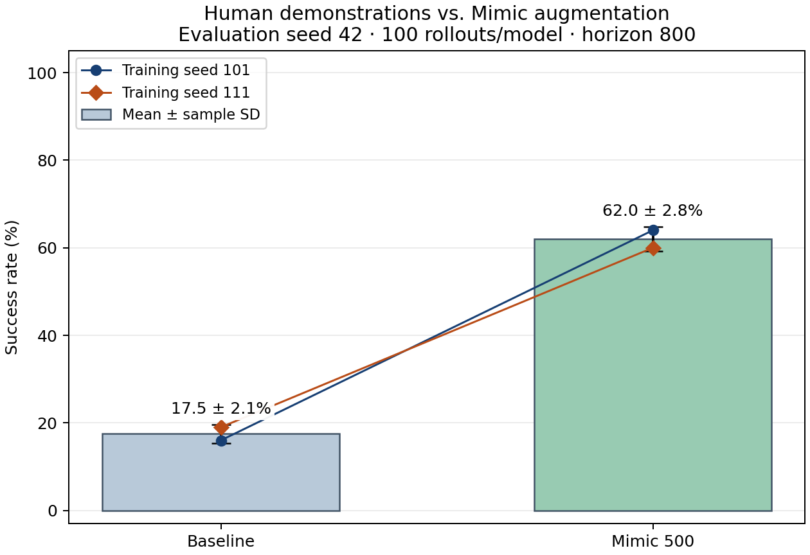

# Toy2Box 모방학습의 물체 획득 실패 진단과 Mimic 증강 효과

일관된 동작 순서에 따라 키보드로 수집한 사람 시범 30개로 강의의 BC 정책을 학습한 결과, 자체 검증 성공률은 **17.5 ± 2.12%**였다. 실패 영상에서 물체를 안정적으로 확보하기 전의 문제가 반복되어, **물체와 손의 상대 위치 변화에 대한 시범의 다양성 부족**을 우선 원인 가설로 설정했다. 동일한 사람 시범에 Mimic 성공 시범 500개를 추가하고 나머지 학습·평가 조건을 유지하자 성공률은 **62.0 ± 2.83%**로 증가했다. 평균 개선 폭은 **44.5%p**이며, 두 학습 seed 모두에서 개선되었다.

정책 성공률 비교는 평가 seed 42, 모델당 100 rollout, horizon 800의 자체 검증 결과다. 평균 ± 표준편차는 학습 seed 101·111의 성공률 두 개로 계산한 **평균 ± 표본 표준편차(ddof=1, n=2)**를 뜻한다. 비공개 seed의 최종 평가 결과는 포함하지 않는다.

## 1. Baseline 재현: 동작 규칙을 통일한 사람 시범 30개

연구 질문은 “사람 시범으로 학습한 BC 정책은 Toy2Box에서 왜 성공률이 저조한가? 원인 하나를 진단하고, 그 원인을 겨냥해 성공률을 높여라”이다. 대상 환경은 `Isaac-Place-Toy2Box-Agibot-Right-Arm-RmpFlow-v0`이다.

시범 간 불필요한 동작 차이를 줄이기 위해 다음 순서를 기준으로 키보드 텔레오퍼레이션 시범 **30개, 총 11,769스텝**을 수집했다.

| 순서 | 수집 동작 규칙 |
|---|---|
| 접근 | 물체 상공까지 이동한다. |
| 정렬·회전 | 물체에 대해 그리퍼 위치를 정렬하고, 잡을 수 있는 방향으로 회전한다. |
| 하강·파지 | 정렬 후 하강하여 그리퍼를 닫는다. |
| 들어 올리기·운반 | 물체를 파지한 뒤 들어 올려 박스 쪽으로 운반한다. |
| 배치 | 박스 안으로 내려놓고 그리퍼를 연다. |

동작 순서의 일관성을 확보하는 것과 다양한 물체·손 상태를 학습 데이터에 포함하는 것은 별개의 문제다. 위 수집 규칙을 적용했음에도, 강의 학습 설정으로 재현한 Baseline의 성공률은 seed 101에서 **16%**, seed 111에서 **19%**에 그쳤다. 이에 동작 규칙을 다시 변경하기보다, 평가에서 어느 단계의 실패가 반복되는지 먼저 분석했다.

학습은 BC-RNN, 2,000 epoch, epoch당 100 update, batch 100을 사용했으며, seed는 학습 설정 JSON의 `"seed"`를 각각 101과 111로 지정했다. 각 학습의 마지막 epoch 2000 모델을 평가했다. [사람 시범 요약](results/mimic500_20261028/human_dataset_summary.json), [Baseline 설정·모델 기록](results/mimic500_20261028/baseline_audit.json)

## 2. 실패 진단: 안정적인 물체 획득 이전에 집중된 실패

접근·파지·운반·배치를 구분하기 위해 각 학습 seed의 평가 영상 중 trial 0–4를 사전에 선택하여 **총 10개**를 검토했다. 영상당 균등 간격 8프레임과 실패 영상의 물체·그리퍼 확대 프레임을 확인했다. 영상상 작업 완료는 4개, 실패는 6개였다.

| 실패 단계 | 판정 기준 및 관찰 | 확인된 실패 수 |
|---|---|---:|
| 접근 | 물체를 잡기 위한 위치·방향에 도달하지 못함. 접근 실패만으로 단독 확정할 근거는 부족했다. | 0 |
| 파지 | 물체 부근에서 그리퍼를 움직였으나 물체를 남겨 두고 빈손으로 상승했다. | 2 |
| 운반 | 안정적으로 들어 올린 물체를 박스로 옮기는 중 실패함. 해당 사례는 관찰되지 않았다. | 0 |
| 배치 | 물체를 박스에 내려놓는 과정에서 실패함. 해당 사례는 관찰되지 않았다. | 0 |
| 접근·파지 경계 불확실 | 물체 부근에서 위치가 어긋난 채 움직인 뒤, 물체를 확보하지 못하고 빈손으로 물러났다. | 4 |

관찰된 실패 **6개 모두 안정적으로 물체를 들어 올리기 전에 발생**했다. 두 seed의 trial 1은 파지 실패로 분류했고, trial 0·2는 접근·파지 경계가 불확실한 사례로 남겼다. 물체를 잡지 못한 상태에서 이후 운반 동작으로 넘어가는 모습이 공통적으로 나타났다.

따라서 이 표본에서 우선 검토할 문제 구간은 **접근·정렬·파지로 이어지는 물체 획득 단계**다. 다만 RGB 표본 프레임만으로 정확한 3차원 간격이나 그리퍼 명령 시점을 알 수 없으므로, 불확실한 4개를 임의로 파지 실패에 포함하지 않았다. 이 10개 영상은 정성 진단용 표본이며, 전체 평가의 실패 단계 비율을 추정하는 무작위 표본은 아니다. 성공률은 별도로 기록한 공식 평가 판정으로 집계했다. [영상별 진단](results/mimic500_20261028/diagnosis/baseline_diagnosis.json), [진단 프레임](results/mimic500_20261028/diagnosis)

## 3. 원인 가설과 예상 결과

시범 수집에서는 접근부터 배치까지의 동작 순서를 통일했지만, 평가에서는 물체 가까이 접근한 뒤에도 위치를 맞추지 못하거나 빈손으로 다음 동작을 수행하는 실패가 반복되었다. 이를 근거로 **수집 동작 규칙의 불일치보다, 제한된 30개 시범이 물체와 손의 상대 위치 변화에 충분히 대응하지 못한다는 설명을 우선 검증 대상으로 선택**했다.

**가설 H1:** 사람 시범 30개로 학습한 BC 정책은 물체와 손의 상대 위치 변화에 충분히 일반화하지 못해 접근·정렬·파지 단계에서 실패한다. 물체 기준으로 변환한 Mimic 성공 시범 500개를 추가하면, 같은 학습량에서 평가 성공률이 높아진다.

이 가설의 관찰 근거는 물체 획득 이전에 집중된 실패다. 상대 위치 다양성 부족은 그 관찰을 설명하기 위한 원인 가설이며, 데이터의 상태 분포를 직접 정량 비교하여 확정한 사실은 아니다. 규칙적인 시범 수집만으로 데이터 품질 문제가 모두 배제되는 것도 아니다.

예상 결과는 두 학습 seed에서 모두 성공률이 증가하는 것이다. 사전 판정 기준은 두 seed 모두 개선되면 일관된 개선, 평균만 증가하고 한 seed가 감소하면 제한적 지지, 평균이 증가하지 않으면 개선 예측을 지지하지 않는 것으로 정했다. [실험 계획](protocol.md)

## 4. 통제 실험: Mimic 성공 시범 추가 여부만 변경

사람 원본 30개를 두 조건에 공통으로 사용하고, 증강 조건에만 Mimic 성공 시범 500개를 추가했다. 정책 구조·관측·행동·최적화·학습량·모델 선택·평가 조건은 동일하게 유지했다.

| 항목 | Baseline | Mimic 증강 |
|---|---|---|
| 사람 시범 | 30개 | 동일한 30개 |
| 추가 Mimic 성공 시범 | 0개 | 500개 |
| 학습 시범 총수 | 30개 | 530개 |
| 학습 seed | 101, 111 | 동일 |
| 정책 | BC-RNN, LSTM 400×2, GMM 5 | 동일 |
| 학습량 | 2,000 epoch, epoch당 100 update, batch 100 | 동일 |
| 최적화 | Adam, learning rate 0.001 | 동일 |
| 시퀀스 길이 | 10 | 동일 |
| 관측·행동 | 강의 low-dim 관측 7종, 행동 7차원 | 동일 |
| 모델 선택 | 마지막 epoch 2000 | 동일 |
| 평가 | seed 42, 100 rollout, horizon 800 | 동일 |

관측은 말단 위치·회전, 그리퍼 위치, 장난감 위치·회전, 박스 위치·회전이다. 모델당 총 **200,000 optimizer update**를 수행했다. 데이터셋 크기가 다르므로 시범당 반복 노출 횟수까지 같지는 않다. 환경의 박스·장난감 위치 분포, 성공 판정, 종료 조건을 임의로 변경하지 않고 강의의 학습·평가 코드를 사용했다. 네 모델의 기록용 평가는 모두 headless·영상 렌더링 없이 동일한 옵션으로 수행했다.

### Mimic 데이터 구성

자료의 `annotate_demos.py --auto` → `generate_dataset.py` → `robomimic/train.py` → `robomimic/play.py` 순서로 진행했다. 생성 환경은 `Isaac-Place-Toy2Box-Agibot-Right-Arm-RmpFlow-Rel-Mimic-v0`이다.

자동 annotation을 통과한 사람 시범은 **28/30개**였다. `demo_0`, `demo_1`은 재생 중 grasp 신호가 검출되지 않아 Mimic 생성 소스에서 제외되었다. 원본 사람 시범 30개는 Baseline과 증강 조건 모두의 학습에 그대로 사용했다. [Annotation 결과](results/mimic500_20261028/annotation_summary.json)

생성 seed 1, action noise 0.01 등 강의의 Mimic 설정을 유지했으며, `generation_guarantee=True`에 따라 성공 시범 500개를 확보했다. 총 **1,389회 생성 시도에서 성공 500개**가 저장되었고, 실패 생성 시범은 학습에 포함하지 않았다. 생성 성공률은 BC 정책의 평가 성공률과 구분한다.

학습 데이터는 **사람 30개 + Mimic 성공 500개 = 총 530개, 222,476스텝**이다. 이 중 사람 시범은 11,769스텝, Mimic 시범은 210,707스텝이다. PDF의 Mimic 단독 학습 예시와 달리 사람 원본을 함께 사용하여, 동일한 사람 데이터에 성공 생성 시범을 추가한 효과를 비교했다. 사람 시범 20–100개, Mimic 성공 시범 최대 1,000개라는 과제 조건을 충족한다. 성공 라벨, 관측·행동의 크기와 길이, 유한값을 검증하고 시범별 출처를 기록했다. [데이터 구성·출처](results/mimic500_20261028/dataset_manifest.json)

실행상 조정으로 RMP 제어기 초기화 비용을 줄이기 위해 생성 병렬 환경 수를 자료의 100에서 8로 변경했다. 환경과 Mimic 변환 코드는 수정하지 않았다. 생성 시 접촉 필터 불일치 메시지가 한 차례 발생했으며, 정상 종료와 저장 데이터 검증을 확인했으나 센서 업데이트에 대한 간접 영향까지 배제하지는 못했다. 세부 근거는 [생성 기록](results/mimic500_20261028/generation_summary.json)과 [병렬 수 조정 기록](results/mimic500_20261028/generation_runtime_retry.json)에 제시했다.

## 5. 결과와 가설 판정

| 학습 조건 | seed 101 | seed 111 | 평균 ± 표본 표준편차 |
|---|---:|---:|---:|
| 사람 시범 30개 | 16 / 100 (**16.0%**) | 19 / 100 (**19.0%**) | **17.5 ± 2.12%** |
| 사람 30개 + Mimic 500개 | 64 / 100 (**64.0%**) | 60 / 100 (**60.0%**) | **62.0 ± 2.83%** |
| Baseline 대비 변화량 | **+48.0%p** | **+41.0%p** | **평균 +44.5%p** |

각 성공률은 공식 성공 판정을 만족한 횟수를 모델당 평가 횟수 100으로 나눈 값이다. 오차선은 학습 seed 두 개의 성공률에 대한 표본 표준편차(ddof=1)이며 신뢰구간이 아니다. 그림의 연결선은 같은 학습 seed의 두 조건 결과를 연결한다. 동일 평가 seed가 개별 rollout의 동일 궤적을 보장한다고 가정하지 않는다. [전체 집계 JSON](results/mimic500_20261028/comparison.json), [결과 CSV](results/mimic500_20261028/comparison.csv)

두 학습 seed 모두에서 성공률이 증가했으므로, **“Mimic 성공 시범을 추가하면 동일한 학습량에서 성공률이 높아진다”는 H1의 개선 예측을 지지**한다. 동작 순서를 통일한 사람 시범 30개만으로는 낮았던 성공률이, 같은 수집 데이터를 기반으로 생성한 시범을 추가했을 때 개선되었다는 점에서 데이터 다양성 확대는 이 실험의 유효한 개선 방향이었다.

다만 **다양성 부족이 유일한 실패 원인이라고 확정할 수는 없다.** Mimic 시범 추가는 데이터 수량, 상태 분포, 생성 궤적을 함께 바꾸므로 각각의 기여를 분리하지 못한다. 동작 일관성의 효과나 다른 수집 방식과의 차이를 직접 비교한 실험도 아니다. 따라서 “수집 방식에는 문제가 없고 다양성만이 원인”이라는 강한 결론 대신, 관찰된 물체 획득 실패를 설명하는 우선 가설과 이에 대응한 증강의 개선 효과를 구분한다.

실패 진단은 영상 10개의 정성 분석이며, 증강 후의 단계별 실패율을 별도로 집계하지 않았다. 따라서 전체 성공률 개선을 접근·파지 실패율의 특정 감소량으로 환산할 수 없다. 또한 자체 검증은 평가 seed 42 하나와 학습 seed 두 개에 한정되므로, 통계적 유의성이나 비공개 최종 평가 seed에서의 성공률은 주장하지 않는다.

## 6. 제출 모델과 재현 근거

최종 제출 모델은 Mimic 증강 조건의 seed 101·111 모델 **두 개**다. 두 모델 모두 마지막 epoch 2000 체크포인트를 사용했으며, 평가 결과에 따라 중간 epoch를 선택하지 않았다. 실행 절차와 평가 명령은 [재현 안내](reproduce.md)를 따른다.

| 최종 모델 | 가중치 | 학습 설정 | 학습 완료·해시 기록 |
|---|---|---|---|
| seed 101 | [mimic500_seed101.pth](../models/mimic500_seed101.pth) | [설정 JSON](results/mimic500_20261028/training/mimic500_seed101/effective_config.json) | [학습 요약](results/mimic500_20261028/training/mimic500_seed101/summary.json) |
| seed 111 | [mimic500_seed111.pth](../models/mimic500_seed111.pth) | [설정 JSON](results/mimic500_20261028/training/mimic500_seed111/effective_config.json) | [학습 요약](results/mimic500_20261028/training/mimic500_seed111/summary.json) |

| 평가 대상 | 최종 판정 요약 | 시행별 기록 |
|---|---|---|
| Baseline seed 101 | [summary.json](results/mimic500_20261028/evaluation/baseline_seed101/summary.json) | [100회 판정](results/mimic500_20261028/evaluation/baseline_seed101/trials.jsonl) |
| Baseline seed 111 | [summary.json](results/mimic500_20261028/evaluation/baseline_seed111/summary.json) | [100회 판정](results/mimic500_20261028/evaluation/baseline_seed111/trials.jsonl) |
| Mimic seed 101 | [summary.json](results/mimic500_20261028/evaluation/mimic500_seed101/summary.json) | [100회 판정](results/mimic500_20261028/evaluation/mimic500_seed101/trials.jsonl) |
| Mimic seed 111 | [summary.json](results/mimic500_20261028/evaluation/mimic500_seed111/summary.json) | [100회 판정](results/mimic500_20261028/evaluation/mimic500_seed111/trials.jsonl) |

네 평가 모두 trial 0–99의 판정 합계와 최종 성공률이 일치함을 확인했다. 모델 SHA256와 체크포인트 내장 학습 설정을 연결하여 seed, 학습 조건, 사용 데이터 및 평가 대상의 대응을 검증했다. 동일 seed의 두 조건에서 데이터 경로·저장 경로·실험 이름을 제외한 학습 설정은 일치한다. [과제 조건](assignment_notice.md), [실험 계획](protocol.md), [재현 안내](reproduce.md)
