# Toy2Box 실제 실행 영상

세 학습 조건에서 **총 12개 원본 MP4**를 선별했다. 각 조건에 성공 또는 시각적 완료 2개와 실패 2개를 배치해 물체 획득·운반·배치 및 재시도 동작을 비교할 수 있게 했다. 모든 영상은 실제 정책 실행 녹화의 **전체 파일을 그대로 복사**한 것이다. 썸네일만 원본 한 프레임에서 추출·축소했다.

각 미리보기와 **원본 MP4** 링크에서 영상을 확인하거나 내려받을 수 있다. 시각은 원본 영상 시작을 0초로 삼으며, trial 번호는 0부터 시작한다.

## 실행과 판정의 구분

| 조건 | 영상 출처 | 영상의 성공·실패 판정 | 공식 자체 검증 결과 |
|---|---|---|---|
| 사람 30개 | 별도 녹화 실행, 100회/seed | 육안 관찰. 해당 실행의 native 라벨 미보존 | 17.5 ± 2.12% |
| 사람 30 + Mimic 500 | 별도 진단 실행, 20회/seed | 같은 진단 실행의 native 라벨·출력 로그 | 62.0 ± 2.83% |
| 사람 100 + Mimic 1,000 | 보고한 평가와 동일 실행, 100회/seed | 같은 평가의 native 라벨 | 66.5 ± 2.12% |

학습 seed는 101·111, 평가 seed는 42, horizon은 800이다. 공식 결과는 모델당 100회 평가의 두 학습 seed 평균 ± 표본 SD다. **이 갤러리의 성공 영상 비율은 성능 지표가 아니다.** 서로 다른 실행의 같은 trial 번호를 연결하지 않으며, 영상 길이로 성공을 판정하지 않는다. Baseline의 ‘시각적 완료’는 native 성공이나 장기 정착 안정성을 보증하지 않는다. [전체 실험 결과](../results.md)

## 사람 30개 Baseline

기존 30개 영상 주석에서 시각적 완료 2개와 접근·파지 실패 각 1개를 선택했다. 네 파일 모두 공식 16%·19% 집계와 별도 촬영 실행이다. [육안 판정 기준과 주석](../video_analysis/README.md)

| 미리보기 · 원본 MP4 | 판정과 관찰 장면 | 길이 |
|---|---|---:|
| <a href="human30_baseline/seed101_trial064_visible_completion.mp4">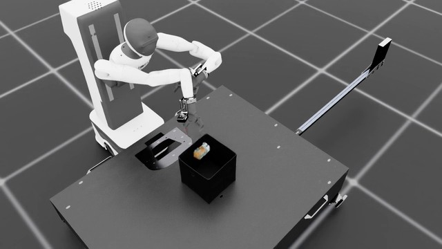</a><br>[원본 MP4 · seed 101 / trial 64](human30_baseline/seed101_trial064_visible_completion.mp4) | **시각적 완료**<br>17.55초 물체가 손과 함께 들리고 19.50초 박스 위로 운반된다. 21.45초 손이 열린 상태에서 물체가 박스 입구 안으로 내려간다. 공식 판정 로그는 이 촬영 실행에 없다.<br>미리보기: 21.45초 | 21.50초 |
| <a href="human30_baseline/seed111_trial078_visible_completion.mp4">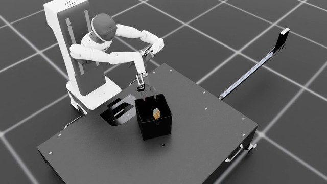</a><br>[원본 MP4 · seed 111 / trial 78](human30_baseline/seed111_trial078_visible_completion.mp4) | **시각적 완료**<br>22.75–25.25초 물체가 손과 함께 들리고 운반된다. 27.80초 열린 손 아래 물체가 박스 입구 안으로 내려간다. 공식 판정 로그는 이 촬영 실행에 없다.<br>미리보기: 27.80초 | 27.85초 |
| <a href="human30_baseline/seed101_trial085_visual_grasp_failure.mp4">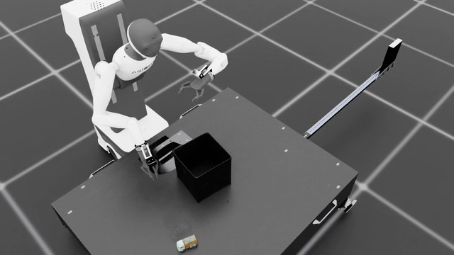</a><br>[원본 MP4 · seed 101 / trial 85](human30_baseline/seed101_trial085_visual_grasp_failure.mp4) | **파지 실패(육안)**<br>13.40초 물체 부근 손가락 접촉 뒤 13.70초 물체가 손과 분리되어 테이블 앞쪽으로 크게 이동한다. 13.95초 이후 빈손이며 물체 운반은 관찰되지 않는다.<br>미리보기: 13.70초 | 40.00초 |
| <a href="human30_baseline/seed111_trial021_visual_approach_failure.mp4">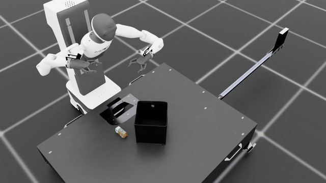</a><br>[원본 MP4 · seed 111 / trial 21](human30_baseline/seed111_trial021_visual_approach_failure.mp4) | **접근 실패(육안)**<br>0.05–5.00초 세부 프레임에서 손이 물체로 내려오지 않고 위쪽으로 이탈한다. 7.25초 이후 물체와 떨어진 상태가 이어지며 물체는 테이블에 남는다.<br>미리보기: 7.25초 | 40.00초 |

## 사람 30개 + Mimic 500개

공식 64%·60%를 집계한 100회 평가는 영상 기록 없이 실행했다. 아래는 같은 모델·평가 코드 해시를 사용한 별도 진단 실행의 영상이다. 해당 실행의 native 라벨은 보존되어 있으나 공식 100회 평가의 trial과 연결하지 않는다. [선별 판정·모델 해시·로그 근거](provenance/mimic500_selected_labels.json)

| 미리보기 · 원본 MP4 | 판정과 관찰 장면 | 길이 |
|---|---|---:|
| <a href="human30_mimic500/seed101_trial000_success.mp4">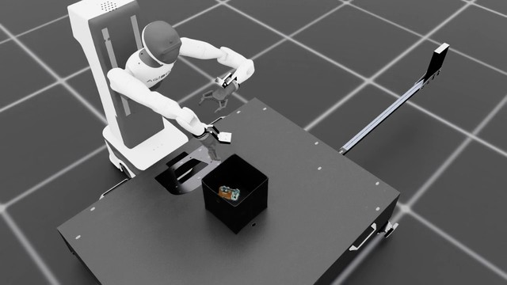</a><br>[원본 MP4 · seed 101 / trial 0](human30_mimic500/seed101_trial000_success.mp4) | **성공**<br>물체를 잡고 들어 올린 뒤 박스 위로 운반해 놓아 성공 판정에 도달한다.<br>미리보기: 20.80초 | 20.85초 |
| <a href="human30_mimic500/seed111_trial004_success.mp4">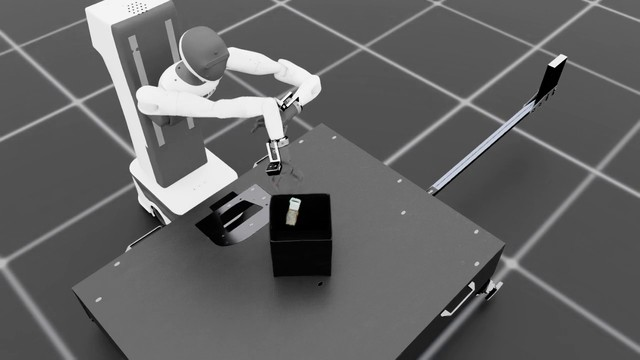</a><br>[원본 MP4 · seed 111 / trial 4](human30_mimic500/seed111_trial004_success.mp4) | **성공**<br>첫 파지 시도가 완결되지 않았으나 다시 접근해 물체를 잡고 박스 안으로 놓아 성공한다.<br>미리보기: 31.00초 | 31.05초 |
| <a href="human30_mimic500/seed101_trial001_failure.mp4">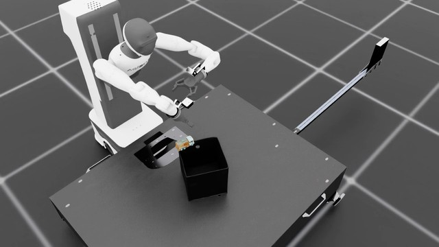</a><br>[원본 MP4 · seed 101 / trial 1](human30_mimic500/seed101_trial001_failure.mp4) | **실패**<br>파지와 운반은 진행되지만 물체가 박스 테두리에 걸쳐 남아 성공 조건에 도달하지 못한다.<br>미리보기: 39.50초 | 40.00초 |
| <a href="human30_mimic500/seed111_trial000_failure.mp4">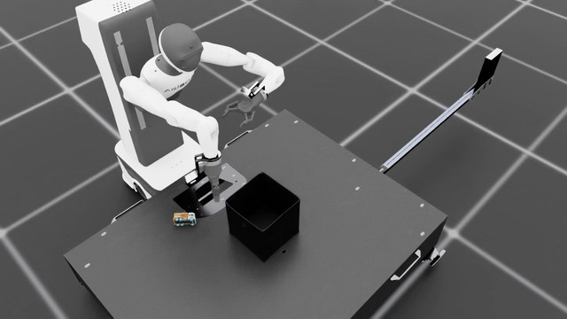</a><br>[원본 MP4 · seed 111 / trial 0](human30_mimic500/seed111_trial000_failure.mp4) | **실패**<br>물체 근처에서 접근과 그리퍼 조작을 반복하지만 안정적으로 들어 올리지 못해 물체가 테이블에 남는다.<br>미리보기: 21.80초 | 40.00초 |

## 사람 100개 + Mimic 1,000개

공식 68%·65%를 집계한 동일 실행의 영상에서 각 학습 seed의 성공 1개·실패 1개를 선택했다. [seed 101 판정](../results/human100_mimic1000/evaluation/seed101/trials.jsonl) · [seed 111 판정](../results/human100_mimic1000/evaluation/seed111/trials.jsonl)

| 미리보기 · 원본 MP4 | 판정과 관찰 장면 | 길이 |
|---|---|---:|
| <a href="human100_mimic1000/seed101_trial002_success.mp4">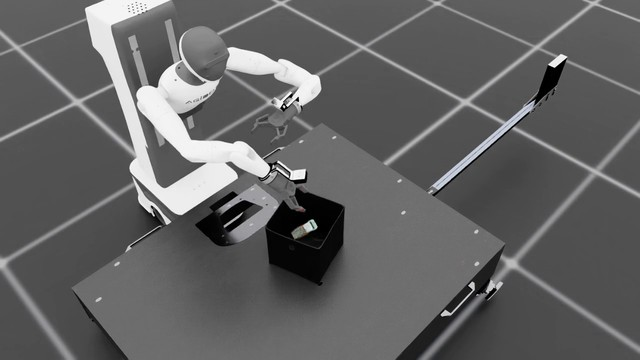</a><br>[원본 MP4 · seed 101 / trial 2](human100_mimic1000/seed101_trial002_success.mp4) | **성공**<br>10.50초 파지를 시작한 뒤 물체를 들어 올려 운반하고, 14.70초 박스 내부에서 해제한다. 해당 시행의 native 성공 판정이 참이다.<br>미리보기: 14.70초 | 14.75초 |
| <a href="human100_mimic1000/seed111_trial000_success.mp4">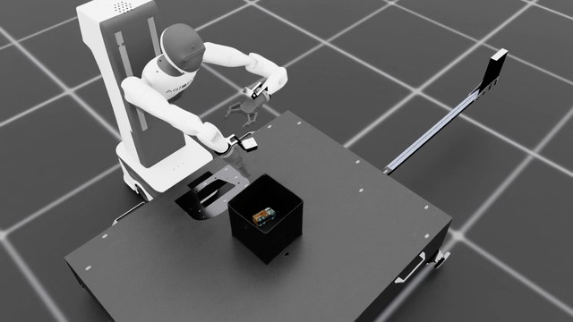</a><br>[원본 MP4 · seed 111 / trial 0](human100_mimic1000/seed111_trial000_success.mp4) | **성공**<br>15.00초 물체를 들어 올린 뒤 놓쳐 18.00초에는 물체가 다시 테이블에 놓인다. 재접근하여 24.00초 다시 들어 올리고 28.00초 박스에 배치한 뒤 29.65초 native 성공 판정을 받는다.<br>미리보기: 29.65초 | 29.70초 |
| <a href="human100_mimic1000/seed101_trial000_failure.mp4">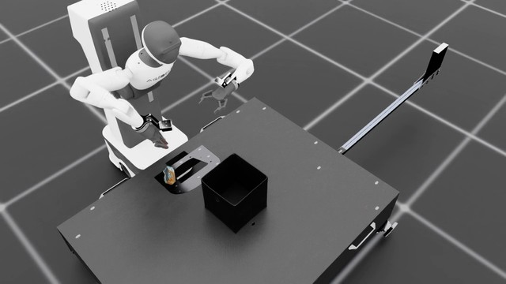</a><br>[원본 MP4 · seed 101 / trial 0](human100_mimic1000/seed101_trial000_failure.mp4) | **실패**<br>14.00–15.00초 물체를 잡아 들어 올리지만 16.00초에는 손과 물체가 분리된다. 물체는 박스 바깥에 남고 800-step horizon까지 과제를 완료하지 못한다.<br>미리보기: 16.00초 | 40.00초 |
| <a href="human100_mimic1000/seed111_trial001_failure.mp4">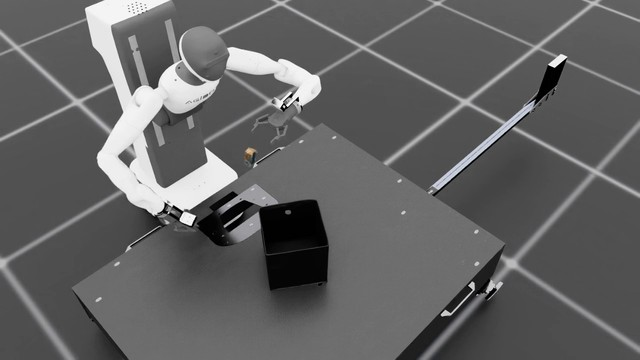</a><br>[원본 MP4 · seed 111 / trial 1](human100_mimic1000/seed111_trial001_failure.mp4) | **실패**<br>15.00–15.75초 물체 부근에서 파지를 시도하나 16.45초 물체가 손과 분리되어 테이블 뒤쪽으로 튕겨 나간다. 종료 직전 저장 상태의 toy z=-0.9126m이며 native 낙하 종료와 실패가 기록된다. 원본 마지막 frame330은 자동 초기화 화면이다.<br>미리보기: 16.45초 | 16.55초 |

## 원본과 무결성

- [manifest.json](manifest.json): 조건·seed·trial, 실행 구분, 판정 출처, 원본 해시, 썸네일 프레임을 연결한다.
- [SHA256SUMS](SHA256SUMS): 원본 MP4 12개의 SHA256. 복사본의 해시는 로컬 원본과 모두 일치한다.
- 전체 평가 영상·상태 배열 및 학습 데이터의 배포 범위는 [데이터 안내](../data/README.md)에 있다. 이 폴더는 선별 영상만 제공한다.

저장소 루트에서 파일을 검증한다.

```bash
cd human_study/videos
sha256sum -c SHA256SUMS
```
